# 智慧机房管控系统

**Smart Server Room Management System**

面向机房运维场景的前后端分离项目，将三维机房可视化、环境监测、能效分析、告警处理、资产管理与网络拓扑集中在同一个管理界面，并接入 LLM 驱动的「小维」巡检助手，辅助查询机房信息、分析告警及处理运维任务。

项目包含管理员可视化大屏与维保人员后台，适合用于机房管理场景展示、学习与功能开发。部分画面和数据用于演示；实际监控、采集和设备控制需接入对应外部服务。

## 功能介绍

| 模块 | 主要内容 |
| --- | --- |
| 机房运维 | 三维机房、分区与机柜查看、设施信息、环境监测、机房事件与巡检展示 |
| 能效管理 | 能耗统计、用电趋势、分类能耗、PUE 与用电异常展示 |
| 告警中心 | 告警概览、等级与状态、告警分析、关联维修工单 |
| 资产总览 | 资产类型、运行状态、位置与空间使用情况、监控画面展示 |
| 网络拓扑 | 网络节点、链路与端口信息、节点搜索及拓扑下钻 |
| 小维巡检助手 | 自然语言对话、上下文查询、工具调用、巡检与工单相关辅助操作；需要确认的操作通过确认卡片提交 |
| 维保与账号管理 | 管理员与维保角色、人员资料、维修工单流转、消息通知与个人账号设置 |

## 项目截图

### 机房运维

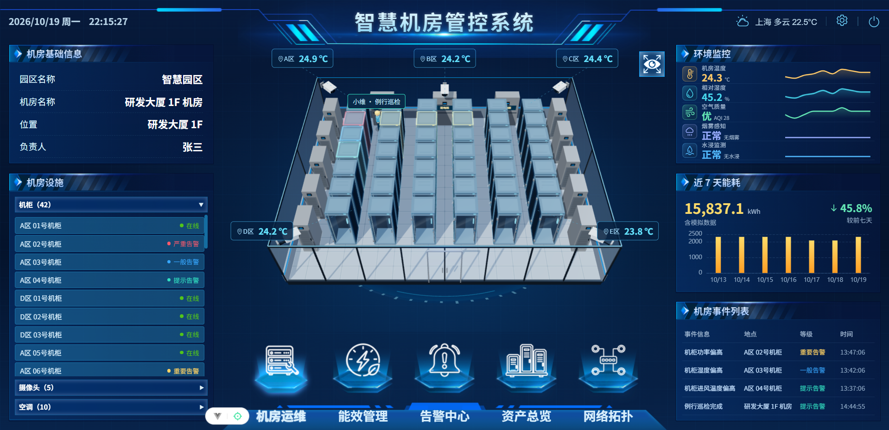

### 能效管理

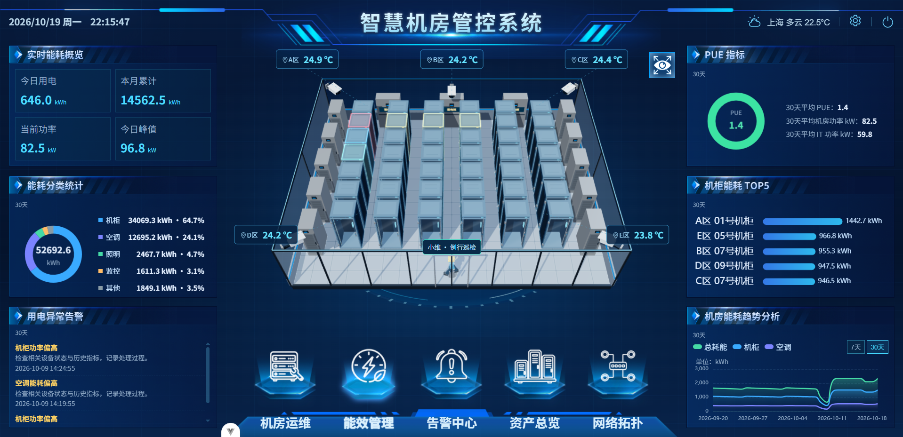

### 告警中心

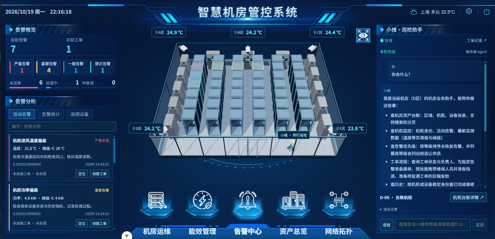

### 资产总览

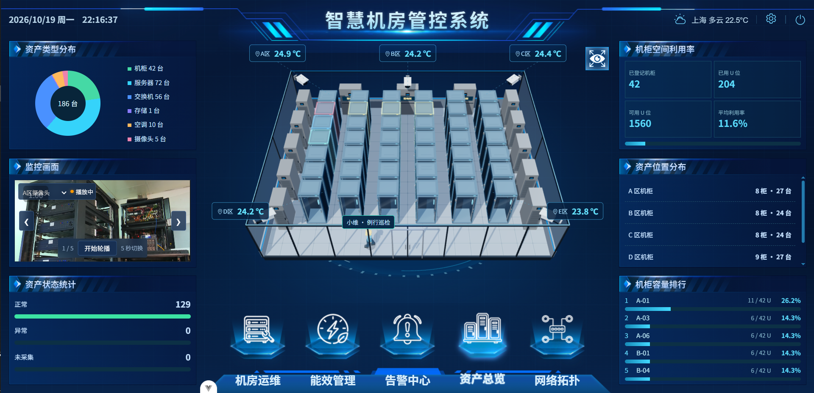

### 网络拓扑

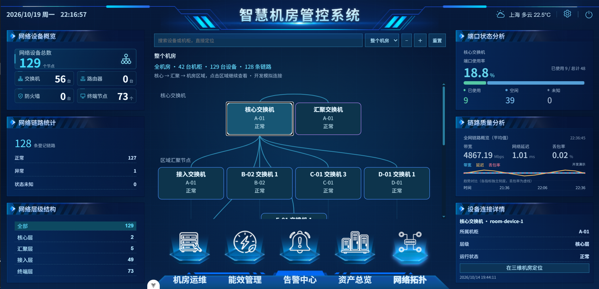

### 管理员设置：监测数据管理

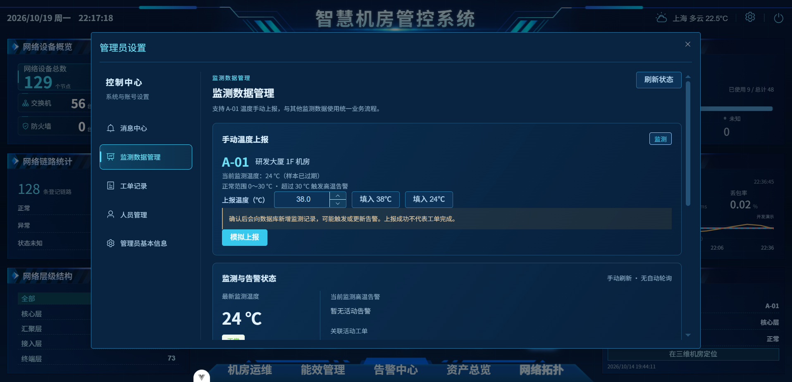

### 管理员设置：工单记录

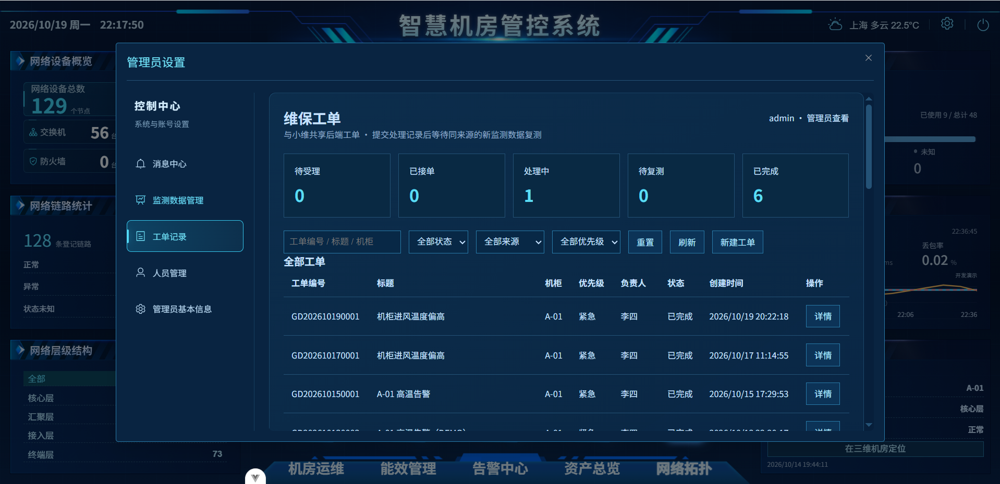

### 管理员设置：工单详情与复检结果

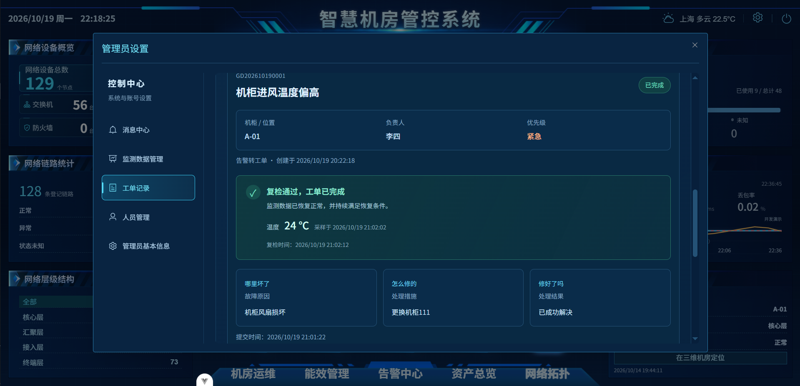

### 管理员设置：人员管理

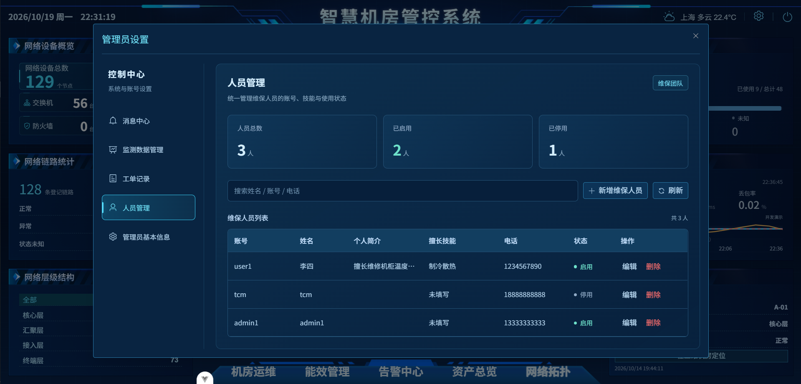

### 管理员设置：管理员基本信息

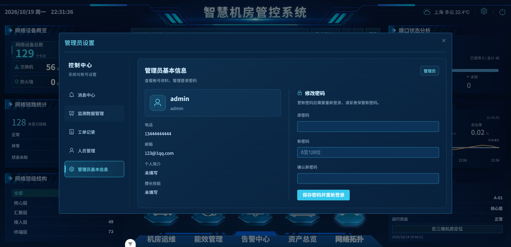

### 维保人员后台

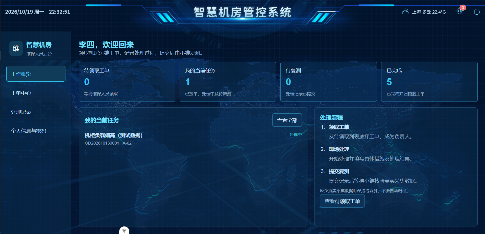

## 技术栈

版本依据当前项目依赖配置；前端精确安装版本以 `package-lock.json` 为准。

| 层次 | 技术 |
| --- | --- |
| 前端框架 | Vue 3、TypeScript / JavaScript、Vite 7 |
| 页面与状态 | Vue Router 4、Pinia 3、Element Plus 2、Sass |
| 三维与图表 | Three.js r160（本地 vendor 模块）、GSAP 3、ECharts 6 |
| 请求与内容展示 | Axios、Markdown-it、HLS.js |
| 后端框架 | Java、Spring Boot 2.6.13、Spring Web |
| 数据访问 | MyBatis Spring Boot Starter 2.3.2、JdbcTemplate、MySQL Connector/J |
| 数据库 | MySQL 8 |
| LLM 接入 | 服务端调用兼容 OpenAI Chat Completions 格式的接口，本文使用 DeepSeek 配置示例 |
| 构建与验证 | Maven、npm、Prettier、Playwright、Spring Boot Test |

## 项目结构

```text
Smart-Server-Room-Management-System/
├── README.md                         项目介绍与启动指南
├── 前端/smart-park-guat-web/
│   ├── public/videos/                监控卡片演示视频
│   ├── src/
│   │   ├── api/                      后端接口封装与数据契约
│   │   ├── assets/                   图片、菜单图标与公共样式
│   │   ├── components/               公共组件、基础菜单与控制台组件
│   │   ├── layouts/                  页面布局、顶部栏与导航
│   │   ├── router/                   路由、登录校验与角色跳转
│   │   ├── services/                 会话、工单等跨页面业务
│   │   ├── stores/                   台账与监测等共享状态
│   │   └── views/
│   │       ├── login/                登录页
│   │       ├── maintenance/          维保人员后台
│   │       └── home/
│   │           ├── cockpit/          机房、机柜、能效、告警、资产与拓扑
│   │           ├── scene/            三维渲染、模型交互与数据适配
│   │           ├── assistant/        小维会话、确认卡片与场景动作
│   │           └── composables/      大屏导航与数据同步逻辑
│   ├── e2e/、tests/                  前端测试
│   └── package.json                  前端依赖与运行命令
├── 后端/smart-park-guat-server/
│   ├── src/main/java/cn/guat/
│   │   ├── SmartparkApplication.java 后端启动入口
│   │   └── smartpark/
│   │       ├── controller/           HTTP 接口
│   │       ├── service/              监测、告警、工单、助手与外部服务
│   │       ├── mapper/、entity/       数据访问与实体
│   │       └── dto/、exception/       数据传输与异常处理
│   ├── src/main/resources/           Spring Boot 配置
│   ├── src/test/                     后端测试
│   ├── database/migrations/          数据库结构与增量脚本
│   ├── database/tools/、scripts/     台账审计与数据维护工具
│   └── pom.xml                       Maven 配置
├── 数据库/                           数据库命名规范与说明
└── docs/                             架构、实现与素材来源说明
```

## 本地启动

### 1. 环境准备

- Node.js：`^20.19.0` 或 `>=22.12.0`，与前端 `package.json` 保持一致。
- JDK：建议使用 JDK 17；后端 Maven 编译目标为 Java 8，部分独立维护脚本需要更高版本 JDK。
- Maven：建议使用 3.8 或以上版本。
- MySQL：8.x。
- 开发工具：IntelliJ IDEA；前端可使用终端或 VS Code。

```bash
git clone https://github.com/lwx1224567/Smart-Server-Room-Management-System.git
cd Smart-Server-Room-Management-System
```

### 2. 准备数据库

默认连接本机 `3306` 端口的 `platform_smart_park` 数据库。在 MySQL 客户端中创建独立开发库：

```sql
CREATE DATABASE platform_smart_park CHARACTER SET utf8mb4 COLLATE utf8mb4_unicode_ci;
```

**首次初始化空库**时，先选择该数据库，再按顺序执行后端 `database/migrations/` 下的：

1. `V001__inventory_schema.sql`：园区、机房、分区、机柜与设备台账结构。
2. `V002__inventory_demo_seed.sql`：台账演示种子数据。

其他运行表由后端相应服务启动时创建或升级。已有数据库请先查看[迁移说明](后端/smart-park-guat-server/database/migrations/README.md)，不要重复执行初始建表脚本，也不要导入旧的 `platform_smart_park.sql` / `user.sql` 历史导出。

上面两份台账种子不包含完整监测历史和登录账号。新用户建议直接使用[初始化与演示数据指南](docs/初始化与演示数据.md)：独立的 `ProjectBootstrap` 工具提供 `admin` 和 `demo` 两个命令，可以在空演示库初始化管理员、42 个机柜、环境监测、7 天能耗、摄像头、拓扑和示例告警，无需手动执行上面的 V001/V002。

**两种初始化方式择一使用**：`demo` 只接受名称以 `_demo` 结尾、业务表为空的数据库；不要先手动写入种子再执行 `demo`。已有业务库只执行 `admin` 创建账号，不执行演示初始化。无固定默认密码，已有同名账号不会被工具重置。

### 3. 启动后端

在 IDEA 中打开 `后端/smart-park-guat-server/pom.xml`，加载 Maven 依赖，并选择 `cn.guat.SmartparkApplication` 作为启动类。

在启动配置的环境变量中设置数据库凭据：

```dotenv
DB_USERNAME=你的数据库用户名
DB_PASSWORD=你的数据库密码
```

数据库地址需要调整时，可通过 `SPRING_DATASOURCE_URL` 覆盖默认连接串，或在本地 `src/main/resources/application-local.yml` 中配置 `spring.datasource`。该本地文件已加入忽略规则，不应提交真实凭据。

运行启动类，后端默认端口为 `8080`。也可以在配置好上述环境变量后，通过终端启动：

```bash
cd 后端/smart-park-guat-server
mvn spring-boot:run
```

使用小维 LLM 能力时，继续完成下一节配置后重启后端。

### 4. 启动前端

在仓库根目录另开终端：

```bash
cd 前端/smart-park-guat-web
npm ci
npm run dev
```

按终端输出的地址访问，通常为 `http://localhost:5173`；端口被占用时以实际输出为准。

前端 `.env.development` 中的 `VITE_APP_BASE_API` 默认是 `http://localhost:8080`。更换后端地址后，需要同步修改并重启前端开发服务。

## LLM 配置方式（DeepSeek）

### IDEA 配置步骤

1. 打开 **Run → Edit Configurations...**，选择后端 `SmartparkApplication` 的启动配置。
2. 点击 **Modify options**，勾选 **Environment variables**。
3. 打开环境变量编辑窗口，逐行添加下表内容。变量名和值分别填写，不要把中文冒号或 Markdown 链接语法一起复制进去。

| 环境变量 | 示例值 | 用途 |
| --- | --- | --- |
| `INTEGRATION_MODEL_KEY` | `替换为你的 apikey` | DeepSeek API Key |
| `INTEGRATION_MODEL_NAME` | `deepseek-flash` | 模型标识 |
| `INTEGRATION_MODEL_URL` | `https://api.deepseek.com/chat/completions` | 完整的 Chat Completions 接口地址 |
| `SPRING_PROFILES_ACTIVE` | `integrations` | 加载 `application-integrations.yml`，启用上述环境变量映射 |

4. 点击 **Apply → OK**，重新启动后端。
5. 登录管理员页面，打开小维助手，发送一条简单查询，检查模型是否正常回复。

也可以在启动参数 **Program arguments** 中填写 `--spring.profiles.active=integrations`，代替 `SPRING_PROFILES_ACTIVE`。已有其他 Profile 时应保留，并将 `integrations` 加入列表。

模型配置示例：

```dotenv
SPRING_PROFILES_ACTIVE=integrations
INTEGRATION_MODEL_KEY=替换为你的apikey
INTEGRATION_MODEL_NAME=deepseek-flash
INTEGRATION_MODEL_URL=https://api.deepseek.com/chat/completions
```

`apikey` 只是占位说明，必须替换为自己的有效密钥。真实密钥仅放在后端环境变量或本地忽略配置中，不要放入前端 `VITE_*` 变量、截图或 GitHub 仓库。

模型名称和服务可用性以 [DeepSeek 官方文档](https://api-docs.deepseek.com/)及自己的账号权限为准。当前后端使用 Chat Completions 与工具调用格式，更换服务商时需要确认相应接口兼容性。

## 常用开发命令

前端目录：

```bash
npm run type-check      # 类型检查
npm run build           # 类型检查与生产构建
npm run preview         # 预览已构建的前端
npm run format:check    # 检查代码格式
```

后端目录：

```bash
mvn test                # 执行后端测试
mvn package             # 打包可执行 JAR
```

部分后端测试依赖独立 MySQL 测试库，运行前请检查 `src/test/resources/application-test.yml` 与测试初始化配置，不要连接生产数据库。

## 使用边界与常见问题

- **新数据库无法登录**：执行独立初始化工具的 `admin` 命令，使用自己设置的密码登录；正常后端启动不会自动创建默认账号。
- **页面没有完整监测图表**：仅导入 V001/V002 时只有基础台账；可在独立空演示库执行 `demo` 初始化合成监测数据，或接入真实采集。演示样例是静态快照，不会自动持续刷新。
- **小维提示模型未配置**：检查 `integrations` Profile 是否启用，环境变量是否加在后端启动配置中，以及修改后是否重启。
- **模型请求失败**：检查 API Key、模型名称、完整接口地址、账号额度及后端网络连接。
- **监控视频**：仓库自带的 MP4 是展示素材；实时摄像头需要接入视频网关。
- **设备控制与数据采集**：需配置对应的 `INTEGRATION_CONTROL_*`、`INTEGRATION_COLLECTOR_*` 等外部服务，不能仅凭演示画面认定已连接真实设备。

## 相关文档与素材

- [前端说明](前端/smart-park-guat-web/README.md)
- [首页代码导航](前端/smart-park-guat-web/src/views/home/README.md)
- [小维 Agent 架构与接口](docs/小维Agent当前架构与接口.md)
- [数据库说明](数据库/README.md)
- [数据库迁移说明](后端/smart-park-guat-server/database/migrations/README.md)
- [界面展示素材来源](docs/界面展示素材来源.md)
- [GitHub 上传排除清单](UPLOAD_EXCLUSIONS.md)
- [初始化管理员与脱敏演示数据](docs/初始化与演示数据.md)
- [系统架构图与告警处理流程](docs/系统架构与告警流程.md)
- [部署指南](docs/部署指南.md)与 [Nginx/systemd 示例](deploy/)
- [主要 API 说明](docs/主要API说明.md)
- [已知限制与开发计划](docs/已知限制与开发计划.md)

## 开源许可与第三方素材

项目维护者有权授权的原创代码与文档采用 [MIT License](LICENSE)。Third-party 库、外部视频及其他素材保留各自授权，详情见 [第三方依赖与素材说明](THIRD_PARTY_NOTICES.md)。原有图片的来源台账仍需补齐，不应将其统一视为 MIT 素材。

已知限制和待实现计划集中维护在[开发计划](docs/已知限制与开发计划.md)中。
