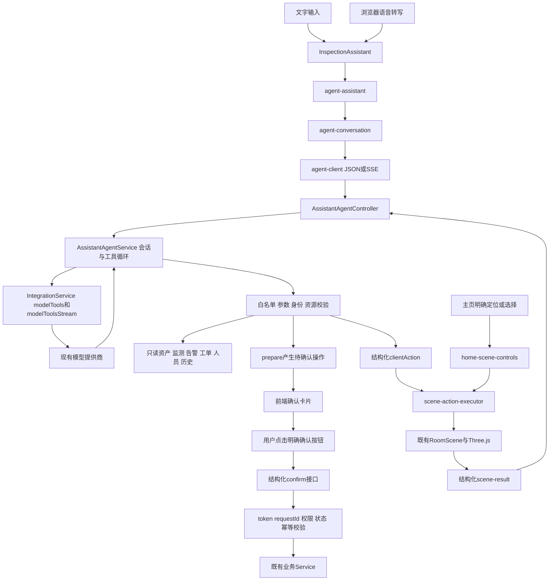

# 小维 Agent 当前架构与接口

本文是阶段4按当前实现核对的有效技术说明。历史阶段报告保留为审计证据，不是当前运行说明。实现完成和模拟测试通过不代表真实模型、数据库、浏览器或动画联调通过。

## 整体架构



模型只选择服务端公开工具，不提供任意SQL、系统命令或物理网关执行能力。正式工单页面的业务操作不属于聊天确认协议，本说明所述“唯一确认入口”指Agent聊天写入路径。

## 前端职责

路径基准：前端/smart-park-guat-web/src/views/home/。

| 模块 | 当前职责 |
| --- | --- |
| assistant/InspectionAssistant.vue、cockpit/alarms/components/InspectionAssistantCard.vue | 聊天与Markdown、语音输入、待办确认卡片、未知结果核对入口；不决定业务工具或编排业务写入 |
| assistant/agent-assistant.ts | Agent控制器工厂、机柜身份上下文、页面生命周期；无workflow/alarm-orders初始化 |
| assistant/agent-conversation.ts | AgentConversationState、会话切换、消息发送、增量显示、场景回执、按钮确认和只读状态核对 |
| assistant/agent-client.ts | Agent JSON/SSE传输；消息完成校验、HTTP错误、超时及读取流关闭 |
| assistant/scene-action-executor.ts | 校验结构化动作和token，调用已有场景；按实际状态生成成功/失败/取消回执，重复token不重放 |
| assistant/home-scene-controls.ts | 主页明确UI选择与定位，不做自然语言解析；复用执行器 |
| assistant/voice-turn.js及声明、AssistantMarkdown.vue | 转写规范化/唤醒/候选评估/朗读文本；Markdown渲染。输入处理不是旧业务规则路由 |
| composables/useHomeDashboard.ts、index.vue | 当前机房与台账身份绑定、主页选择/定位、业务页面导航、生命周期；不注入旧模型适配器 |

文字提交和语音最终转写均调用同一个command(text)，转入服务端模型工具循环。语音“确认”“好的”等不提交confirm。语音唤醒和转写质量选择仍保留，不代表前端理解业务意图。

mode为“服务端 Agent”UI标签，不是可切换执行模式；capabilities中的agentEnabled当前固定true，是兼容能力元数据，主页不依赖它切换本地助手。三维相关模型、材质、相机、光照、布局、动画均沿用现有实现。

## 后端职责

路径基准：后端/smart-park-guat-server/src/main/java/cn/guat/smartpark/。

| 模块 | 当前职责 |
| --- | --- |
| controller/AssistantAgentController | 当前身份、页面标识与Agent路由；JSON信封或SSE帧 |
| service/AssistantAgentService | 账号+机房+页面会话与锁、大模型循环、工具参数校验、候选校验、pending与确认记录、场景token及回执 |
| service/AssistantAssetTools | 现有InventoryService只读适配，分页/稳定ID/当前机房归属/缺失值约束 |
| service/AssistantPriorityAlarms | 当前机房未恢复告警排序、机柜映射、候选同级澄清信息；不写告警 |
| service/IntegrationService | 共享modelTools/modelToolsStream与HTTP网关；同时保留采集、视频、控制等正式业务方法，不可整类删除 |
| ConsoleAccessFilter、ConsoleService、MonitoringService、InventoryService等 | 既有认证、管理员角色、资源归属、工单事务/状态/幂等和复检规则；不由模型替代 |

正常Spring注入时共14个白名单工具。循环最多6轮、12次工具调用，时间预算60秒；这不是事务超时或后台任务保证。模型失败明确中断，不切回旧规则，也不重放业务写入。

## Agent API

共同前缀：`/api/v1/assistant/rooms/{room}`。room来自请求路径，工具不能自行指定其他机房。身份使用现有Bearer认证，当前Agent属于管理员功能。`X-Assistant-Page`为1～64位字母/数字/下划线/连字符，默认default；前端生成独立页面UUID。会话键为账号ID、room和页面标识。

| 方法/后缀 | 请求 | 主要结果 |
| --- | --- | --- |
| GET /session | 无body | 当前会话 |
| POST /session/end | `{}` | 删除当前内存会话，不执行业务 |
| POST /chat | text字符串、requestId字符串；可选sceneCabinet、stream布尔值 | 模型回复、工具结果、pending或clientAction |
| POST /scene-result | 下述场景回执；可选stream | 消费当前动作token；成功后继续模型循环，失败不推进后续业务 |
| POST /confirm | pendingToken、kind、requestId，均字符串，禁止其他字段 | confirmation记录与会话；这是按钮写入入口 |
| POST /confirmation/status | 同一pendingToken/kind/requestId | 只读确认记录和actualOrders，绝不重提写入 |
| POST /pending/dismiss | pendingToken | 消费/关闭待办，不写业务 |

JSON使用现有R信封：code、msg、data、requestId、serverTime、error。不要把信封requestId与客户端业务确认requestId混为一谈。常见data为：

```json
{
  "reply": "准备指派，请核对卡片",
  "messages": [{"role":"assistant","text":"准备指派，请核对卡片"}],
  "context": {"orderId":"WO-EXAMPLE","cabinetKey":"A-01"},
  "pending": {"kind":"assign","token":"示意令牌","summary":"准备指派 WO-EXAMPLE"},
  "trace": [],
  "interrupted": false
}
```

示例不是实际数据。pending由服务端生成，实际对象还可能包含准备时间、草稿、状态指纹等内部字段，前端不能伪造或据此自行写业务。context用于会话提示，不代替重新查询或资源校验。缺少字段按实际响应处理，不能补造成功结果。

## 工具清单

所有工具拒绝未知参数、校验类型/枚举及适用范围；表内条件必填由工具执行器进一步校验。

| 工具 | 参数 | 行为 |
| --- | --- | --- |
| get_room_info | 无 | 当前机房资产信息 |
| list_cabinets | zoneId?、q?、page?、pageSize? | 当前机房机柜分页 |
| get_cabinet_info | cabinetId或cabinetKey二选一 | 当前机房机柜详情 |
| list_devices | cabinetId或cabinetKey二选一；q?、type?、page?、pageSize? | 指定机柜设备分页，type为SWITCH/SERVER/STORAGE/OTHER |
| get_device_info | deviceId | 稳定设备ID只读详情，不虚构设备字段 |
| get_priority_alarms | cabinetKey?、limit? | 当前机房未恢复告警；默认20、上限100，明确截断范围 |
| get_monitoring | cabinetKey? | 当前机房监测与活动告警；显式cabinetKey限定机柜，省略则工具按机房查询，不由场景选中状态隐式缩小 |
| get_orders | orderId?、cabinetKey?、alarmId? | 工单、负责人、处理与复检依据 |
| prepare_order | alarmId、cabinetKey | 准备建单；同告警已有工单则复用，不写入 |
| recommend_people | orderId | 启用维保人员、技能推荐与selectionCandidates服务端顺序 |
| prepare_assignment | orderId；ownerAccountId?、ownerUserName?、ownerDisplayName?、recommendationIndex? | 唯一用户选择及状态校验后仅准备指派；未指定/重名/冲突均澄清 |
| prepare_retest | orderId | 仅准备待复测工单的后端数据复检，不决定通过或归档 |
| get_history | cabinetKey?、deviceId?、recordOrigin?当前枚举REAL | 历史查询；工具描述建议提供稳定身份，当前schema和执行允许省略资源筛选，仍受当前机房范围约束 |
| scene_action | action；visit/status/door需cabinetKey，door另需open布尔值；resume/cancel不提供目标 | 仅三维模型动作，不调用物理控制网关 |

资产分页默认page=1、pageSize=20，上限100；返回range中的page/pageSize/total/returned/from/to/hasMore及scope，单页不是完整台账。data缺失字段及null/未采集按工具missingValueMeaning说明，不推测设备属性。

告警等级顺序critical→warning→normal→info→未知，对应严重/重要/一般/提示/未标明。同等级按稳定ID仅用于展示，不代表业务优先顺序；最高等级并列必须选择，不能让模型猜先后。无有效机柜映射时可以展示告警，但inspectable=false，不生成虚假定位目标。

人员账号和稳定ID精确匹配，姓名只接受唯一候选，序号仅对应当前有效selectionCandidates顺序。推荐快照绑定机房、工单、状态指纹、请求和10分钟有效期；切单、切页、状态变化、过期不得复用旧序号。工具字段与本轮用户选择冲突时不猜测；无人员选择不默认第一名。资格沿用既有维保目录和业务Service，不新增虚构的人员机房字段。

get_history的描述建议提供机柜或设备身份，但当前schema不强制，执行器可向既有Service提交空资源筛选；本文不将“至少一种”写成已实现的强制校验。是否统一描述或收紧参数需另行决策，本阶段不改工具语义。

数据来源完全沿用现有业务Service与归一化策略，历史DEMO标记不构成新增执行通道；本阶段不修改DEMO/REAL含义。

## SSE和场景动作

chat/scene-result的stream=true可触发SSE；前端发送Accept: text/event-stream。每帧格式：

```text
event: delta
data: {"text":"一段回复"}

```

| event | data |
| --- | --- |
| status | `{message}`，当前工具进度 |
| message_start | `{}`，开始新的模型回复 |
| delta | `{text}`，回复文本片段；工具参数片段不作为文本增量播出 |
| done | 原始会话对象（不是R包装）；合并最终消息 |
| error | `{message}`；中断，不能当done |

客户端必须收到done才能认定响应完成；处理UTF-8分片和CRLF，结束时关闭reader。Controller通过刷新响应发送帧；真实部署代理缓冲和网络行为仍待阶段5验证。

服务端返回动作示例：

```json
{"token":"示意动作令牌","type":"door","cabinetSceneModelKey":"A-01","open":true}
```

执行器只接受visit/status/door/resume/cancel。目标须映射到当前台账且存在于就绪场景；door要求布尔open并拒绝锁定柜门。visit必须实际到达对应deviceId并确认选中；door等待模型开关状态和角度到位（最多8秒），不能把未结束动画标成完成。resume/cancel核对巡检模式。动作取消不撤销已经发生的模型状态。

```json
{"token":"示意动作令牌","type":"door","status":"SUCCEEDED","cabinetSceneModelKey":"A-01","open":true,"arrived":false,"code":"DOOR_SETTLED","result":"示意模型动作结果"}
```

示例code来自当前执行器；服务端验证token/type/status/目标/open/arrived一致性。status为SUCCEEDED/FAILED/CANCELLED；arrived仅visit成功为true。token只能消费一次，未知/过期上下文/目标不符/重复回执被拒绝。前端同token同动作缓存回执，不重复执行；同token不同参数拒绝。queryAfterArrival是执行器保留的受限兼容字段，当前服务端工具不生成它，也不会据此调用旧查询器。

## 结构化确认与失败处理

1. 模型调用prepare_*，只生成pending，不写业务。新自然语言消息会使旧pending失效，模型可根据新请求重新准备。
2. UI展示服务端summary及明确按钮：确认创建工单、确认指派、确认复检。文字/语音“确认”仍是模型输入，不能执行写入。
3. 点击按钮绑定pendingToken、kind(create/assign/retest)、新requestId；同步锁定重复点击。
4. 后端确认身份与当前会话待办，验证token/kind、10分钟有效期、资源状态指纹和权限。创建复用/指派/复检状态、事务锁与重复创建保护继续由既有Service处理。
5. 确认记录在实际调用前保存UNKNOWN并消费pending；成功SUCCEEDED，确定拒绝REJECTED，无法确定结果保持UNKNOWN。同token+kind+requestId重试返回记录，不能再次执行；不同请求绑定不能复用已消费token。
6. 传输超时后前端只调用confirmation/status，展示当前actualOrders；不能根据某个订单状态自行将UNKNOWN推断为本次成功/失败，不自动重提。
7. 取消/关闭卡片调用dismiss，不执行写入；切会话或销毁页面不触发确认。真实HTTP请求未实现任意用户按钮级的网络abort保证，页面版本检查负责忽略过时结果，场景取消独立处理。

前端请求超时当前100秒；共享HTTP网关连接5秒、读取15秒。内存会话/确认记录不持久化，进程重启或session/end后令牌不可复用，未知结果可能需人工核对业务实际状态。chat requestId只重放最近同请求的会话结果，不等于所有请求永久幂等；确认记录和业务幂等各司其职。

## 已删除内容、配置边界和测试

旧关键词/意图/规则工单编排及前端模型适配文件在阶段3B删除；/api/v1/assistant/chat、IntegrationController.model和IntegrationService.model在阶段3C删除，无410、重定向或新Agent转发。通过正常鉴权的旧路径请求404；匿名或无角色请求可能先被通用Filter拒绝，这不是旧路由仍在。

保留VITE_APP_BASE_API、INTEGRATION_MODEL_URL/NAME/KEY等当前网关配置，以及现有超时、SSE和其他视频/采集/控制配置。仓库未发现需要在阶段4额外删除的旧助手专属配置。不得在文档、日志或示例填写真实Key/token。

阶段4执行无数据库验证：前端类型/生产构建、会话/确认/场景/主页模拟；后端9个指定测试类（Agent、安全、人员、资产、优先告警、场景、MockMvc、模型网关与SSE）。检查脚本check-inspection-assistant.mjs只启动测试工作进程，不启动浏览器或数据库服务；脚本外另有2项工单模拟回归。

AssistantAgentIntegrationTest的22个数据库用例保留并迁移到新协议，阶段4只编译。它们仍含数据库fixture和业务写入，不能因为存在测试profile或事务回滚就擅自运行。阶段5必须先确认隔离环境；测试方法中的数据库名断言早于实际用例，但晚于Spring初始化，不能替代启动前的安全隔离。

## 阶段5待验证项目

- 真实模型工具选择/参数、人员候选顺序和澄清、模型失败行为。
- 部署HTTP/SSE首段、中文分片、中断、代理缓冲和旧路径不可达。
- 浏览器语音、确认卡片、重复点击、切房切页、中断只读核对。
- 真实Three.js定位/巡检/取消/恢复/锁定与柜门动画到位，不以模拟成功冒充。
- 经单独授权的隔离测试库验证工单重复创建、指派资格变化、资源状态变化、复检和事务并发；不得使用真实业务工单作写入样本。

阶段4不提供上述真实联调通过结论。阶段5需用户验收阶段4，并单独明确环境、允许的读写范围、测试账号/资源、初始化行为、清理责任和失败处理；未经批准不得启动后端或真实写入。
