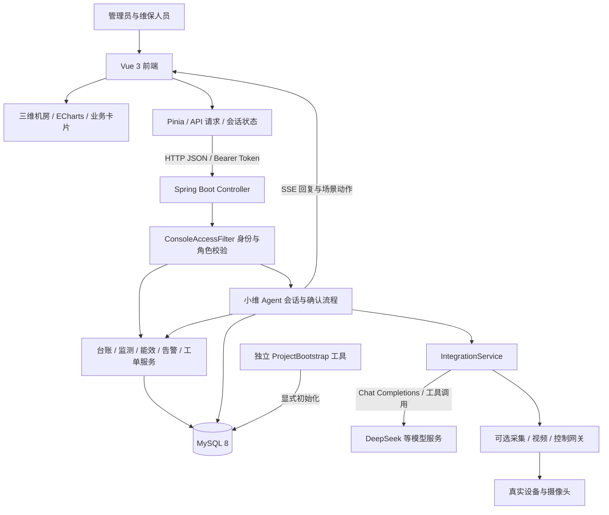
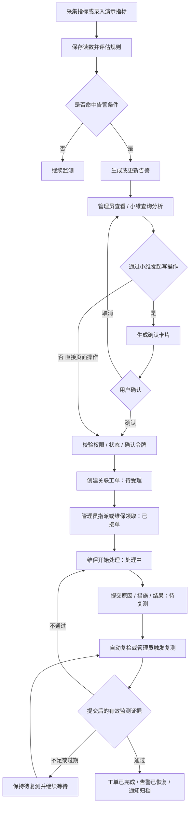

# 系统架构与告警处理流程

## 系统架构

- 前端负责三维表现、页面交互与服务端状态展示；模型密钥保留在后端。
- `/api/v1/` 接口由过滤器校验会话；大屏、台账及外部集成等接口要求管理员角色，维保人员使用个人工单和通知接口。
- 小维通过服务端工具访问业务能力；需要确认的写操作生成确认卡片，提交确认后才执行。前端场景动作的成功不等于物理设备操作成功。
- MySQL 保存台账、监测记录、能耗、工单、通知、会话与编号映射。当前部分 schema 升级由服务启动逻辑承担，没有自动扫描全部 SQL 的 Flyway 配置。
- 公共演示工具不属于 Web 请求路径，不会提供免登录的创建管理员接口。

## 告警与维修闭环

实际工单状态为 `待受理 → 已接单 → 处理中 → 待复测 → 已完成`；复检不通过回到 `处理中`，缺少有效证据保留 `待复测`。管理员指派已有处理中工单时不会无条件重置状态。

重复关联同一未恢复告警时，服务优先返回已有未完成工单。操作可携带 `expectedState` 检查状态、负责人和更新时间，冲突返回 409 后应重新读取。演示复检与真实证据复检具有不同含义，不应将演示结果作为设备恢复凭证。
